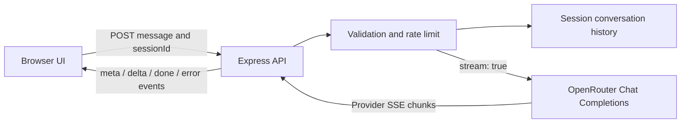

# Nova AI — Streaming LLM Chat

Nova AI is a lightweight, general-purpose AI chat application built to demonstrate practical LLM integration. Ask open-ended questions about programming, learning, writing, brainstorming, planning, analysis, or everyday topics. The application streams model output to the browser as it arrives instead of waiting for the full response.

**Stack:** JavaScript · Node.js · Express · OpenRouter · Server-Sent Events (SSE) · Fetch Streams

## Features

- **Streaming responses:** Express consumes OpenRouter's streamed Chat Completions output and relays incremental text updates to the browser using SSE.
- **Conversation context:** recent user and assistant turns are included in follow-up requests so the model can respond with context.
- **Open-ended assistant:** a general-purpose system prompt supports a wide range of questions instead of restricting the app to an unconnected business workflow.
- **Model configuration:** change `OPENROUTER_MODEL` in `.env` without modifying application code.
- **Server-side secrets:** the OpenRouter API key is read from `.env` and is never sent to frontend JavaScript.
- **Responsive chat UI:** clean conversation layout, suggested prompts, connection/model status, live-generation feedback, clear-chat and stop-generation controls.
- **Request safeguards:** message length validation, JSON payload limit, basic per-IP rate limiting, bounded in-memory sessions, and clearer provider errors.
- **No heavyweight frontend stack:** the UI uses plain HTML, CSS and browser JavaScript; no frontend build step or database is required.

> **Important limitation:** Nova generates answers from the configured LLM. It does not automatically browse the web, execute code, access private accounts, or perform external actions. AI responses can be inaccurate, so verify important information.

## Architecture



The browser reads the response body with the Fetch Streams API. The server parses OpenRouter's SSE frames and forwards a small, consistent event format to the client. The provider API key stays on the server.

## Project structure

```text
jsDemo/
├── public/
│   ├── index.html     # Chat interface markup
│   ├── styles.css     # Responsive visual styling
│   └── app.js         # Streaming client, events and UI state
├── .env.example       # Environment configuration template
├── .gitignore
├── package.json
├── README.md
├── server.js          # Express API, OpenRouter adapter and SSE relay
└── test.js            # Automated integration tests using a mock OpenRouter provider
```

## Requirements

- Node.js 20 or newer
- OpenRouter API key
- Internet connectivity for model requests

## Run on Windows

1. Extract `jsDemo.zip`.
2. Open the extracted `jsDemo` folder in VS Code.
3. Open **Terminal → New Terminal** and confirm you are in the folder containing `package.json`.
4. Install dependencies:

   ```powershell
   npm install
   ```

5. Create your local environment file:

   ```powershell
   Copy-Item .env.example .env
   ```

6. Open `.env` and add your actual OpenRouter key:

   ```env
   OPENROUTER_API_KEY=your_real_key_here
   OPENROUTER_MODEL=openrouter/free
   PORT=3000
   ```

7. Start the app:

   ```powershell
   npm start
   ```

8. Open **http://localhost:3000** in Chrome or Edge. Keep the terminal running while using the chat. Press **Ctrl+C** to stop the server.

For development with automatic restarts, run `npm run dev`. To run JavaScript syntax checks, use `npm run check`.

## Run automated tests before pushing to GitHub

After `npm install`, run:

```bash
npm run check
npm test
```

`npm run check` validates JavaScript syntax. `npm test` launches the real Express app and a local mock OpenRouter endpoint, then checks the health route, static frontend assets, request validation, API-key handling, non-streaming chat, same-session conversation context, SSE streaming events, provider errors, empty responses, and clearing history. The test provider is local: **tests do not need your real OpenRouter key, internet access, or model credits**.

A passing suite means these behaviors passed against the mock provider; it does not prove your real OpenRouter account, model availability, or internet connection works. After the automated tests pass, run `npm start` and send a real prompt in the browser to verify your own OpenRouter configuration before pushing.

## Configure the model

Set `OPENROUTER_MODEL` to a model slug that is currently available to your OpenRouter account. `openrouter/free` is a convenient starting point when a free model is available, but model availability, limits, and provider behavior can change. Restart the server after editing `.env`.

Official streaming reference: <https://openrouter.ai/docs/api-reference/streaming>

## API reference

### `GET /api/health`

Returns server status, configured model, provider, streaming capability, and whether an API key has been configured. It never returns the secret itself.

### `POST /api/chat/stream`

Request JSON:

```json
{
  "sessionId": "browser-session-id",
  "message": "Explain JavaScript closures with a practical example."
}
```

Response content type: `text/event-stream`. Named events:

- `meta` — configured model details
- `delta` — incremental text content, for example `{ "content": "A closure..." }`
- `done` — response completed
- `error` — provider or stream error

### `POST /api/chat`

Non-streaming JSON endpoint for simple clients. Returns `{ "reply": "...", "model": "..." }` and uses the same session context.

### `DELETE /api/chat/:sessionId`

Clears the in-memory conversation associated with the supplied session.

## Design choices and limitations

- **Why SSE:** generation mainly streams in one direction—from server to browser—so SSE is simpler than a bidirectional WebSocket connection for this use case.
- **Bounded in-memory history:** the demo keeps recent turns in memory to stay easy to run. Restarting the server clears them; a multi-instance deployment would need shared storage such as Redis or a database.
- **Basic rate limiting:** the included in-memory limiter is appropriate for a local portfolio demo, not a hardened public service. Production deployments should use shared, maintained rate limiting and configure trusted proxies carefully.
- **No tools or retrieval:** this is a direct LLM integration. Web browsing, retrieval-augmented generation (RAG), code execution, authentication, and persistent chat storage are outside its current scope.
- **Data handling:** prompts and responses are sent to the configured OpenRouter model provider. Do not enter credentials or sensitive personal information.
- **Secret handling:** keep `.env` private; commit `.env.example` instead. Never put `OPENROUTER_API_KEY` in `public/app.js` or other browser code.

## Troubleshooting

- **`npm` is not recognized:** install Node.js 20+ and reopen the terminal.
- **API key missing:** verify `.env` is in the project root and restart the server.
- **401 / 403:** check the API key, account settings and access to the selected model.
- **429 / quota error:** check your OpenRouter usage limits or try again later.
- **Model unavailable:** choose a model slug available to your account.
- **Port already in use:** set `PORT=3001` in `.env`, restart, and open `http://localhost:3001`.
